# High-innovative Prediction Model Based on Feature-Time Dual Attention and BiGRU Global Attention Parallel Fusion

\tPreface
This issue proposes a parallel graph attention bidirectional gated recurrent unit (GATBiGRUAttention) model for predicting transformer oil temperature. This model takes historical multi-variable monitoring sequences as input, and constructs
\tFeature-oriented Graph Attention
\tTime-oriented Graph Attention
\tBidirectional GRU Global Attention Branch (BiGRU-Global Attention)
\t  
Extracting oil temperature change features from three perspectives: variable dependency, time dependency, and bidirectional sequential dynamic. This paper details the model architecture, implementation details, and experimental validation, providing significant guidance for transformer operational status monitoring and intelligent maintenance. The integration of variable graph dependency, time graph dependency, and bidirectional sequential attention representation enhances the predictive model's ability to represent complex states and generalize performance, applicable to other time series prediction tasks.
We also provide detailed materials, instructional documents, and video tutorials, including how to replace your own dataset, parameter tuning tutorials, etc. The code is commented line by line, with detailed introductions of parameters:
● Dataset: Power Transformer Oil Temperature Dataset
● Environment Framework: Python 3.11, PyTorch 2.1 and above can be run.
● Model score: 0.98 on test set
● Usage: Paper requirements, graduation design requirements.
● Code Guarantee: The code comments are detailed and ready to run.
1. Introduction to the innovative model
2.1 Overall Architecture Design
In terms of model architecture, the feature-oriented graph attention branch treats each monitoring variable as a graph node, learning implicit correlations between different variables through adaptive attention weights; the time-oriented graph attention branch considers each time step within the sliding window as a graph node, capturing dynamic dependencies between non-adjacent moments; the BiGRU global attention branch utilizes bidirectional Gated Recurrent Units to extract both forward and backward temporal context, and strengthens the contribution of key time segments through a global attention mechanism. After outputting from three branches, they are fused in feature dimensions, and future oil temperature predictions are output through a linear prediction layer.
2.2 Branch One: Feature GAT
Who has a stronger relationship between different features?
For example:
Wind speed and pressure may be related.
Wind speed and humidity may also be related.
Some features are redundant.
This journey involves treating "features" as nodes in a graph, learning about "variables and their relationships."
\t2.3 Branch Two: Time GAT
In a given time window, which moments are more important?
For example, predicting the wind speed for the next hour using the past 24 hours:
Perhaps the most important thing in the last hour.
Perhaps the same moment 24 hours ago is also important.
Perhaps a few mutation moments contribute significantly.
This process treats "time steps" as nodes in the graph, learning about the relationships between moments and moments.
2.3 BiGRU-Attention branch
\t  
Multi-feature sequence data is processed simultaneously through a BiGRU network optimized with GlobalAttention. GlobalAttention is a mechanism designed to enhance the model's focus on different parts of the input sequence. In the BiGRU model, the global attention mechanism helps the model concentrate more on the relevant parts of the input sequence, thereby enhancing the model's performance and generalization capabilities. At each time step, the global attention mechanism calculates a weight vector that represents the model's focus on various parts of the input sequence. These weights are then applied to the feature representations output by the BiGRU, allowing for weighted consideration of all features across positions, enabling the model to pay more attention to important temporal features. This enhances the model's ability to perceive temporal features in multi-feature sequences.
3. Power Transformer Data Set Introduction
3.1 Import Data
3.2 Data Set Creation and Preprocessing
For detailed information, please refer to the provided documents!
4. Parallel Prediction Model Based on GAT-BiGRUAttention
4.1 Define the parallel prediction network model of GAT-BiGRUAttention
4.2 Set parameters and train the model
The GAT-BiGRUA attention model has shown significant predictive effects. The model consists of three branches: Feature-oriented GAT, Time-oriented GAT, and BiGRU-Global Attention. These branches extract oil temperature change features from three aspects: variable dependency, time dependency, and bidirectional temporal dynamics. The model converges quickly, exhibits excellent performance, and achieves high prediction accuracy. By appropriately adjusting the model parameters, further improvements in model prediction performance can be achieved.
5 Results Visualization and Model Evaluation
5.1 Visualization of Prediction Results
5.2 Model Evaluation
Click to download: Complete original data, Python code
Previously Featured Content:
Informer prediction model collection: new feature importance analysis!  
Rapid Fourier Transform (FFT) brute force surge in prediction! High-innovation time series classification model based on time-frequency feature fusion  
STL-VMD secondary decomposition + Informer-LSTM parallel prediction model  
Continued updates! Attention mechanism + Lithium Battery Remaining Life Prediction collection  
Directly write for the first zone! CEEMDAN decomposition + Informer-LSTM +XGBoost combination prediction model  
Comparative prediction models based on Informer-SENet for photovoltaic power generation power prediction! Six sets of comparative prediction models, directly written for graduation and minor theses/dissertations!  
High innovation! Prediction model based on ICEEMDAN+SHAP interpretability analysis for Lithium Battery Remaining Life Prediction  
Prediction models based on Informer-BiGRUGATT-CrossAttention  
High innovation! Prediction model based on ICEEMDAN+MSCNN-BiGRU-Attention parallel prediction model  
Air Quality PM2.5 Concentration high innovation prediction model! Prediction model based on VMD rolling decomposition + attention mechanism parallel prediction model  
End  
\t2. Friends who like can click to follow, give the article a "like", share on WeChat Moments or discuss groups

## Images

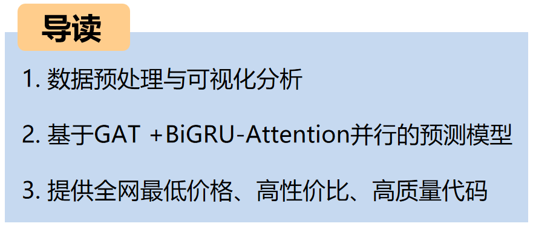
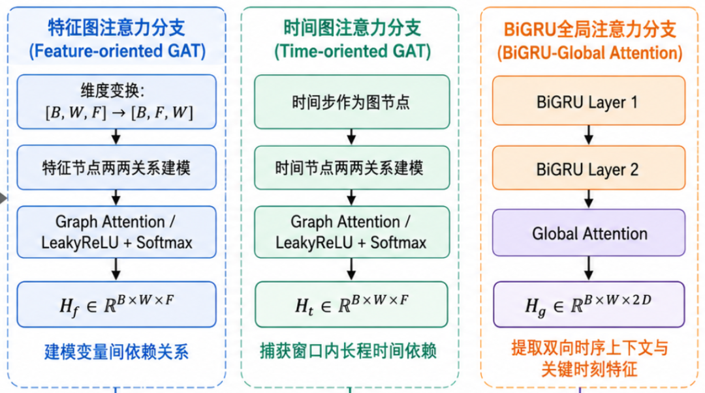

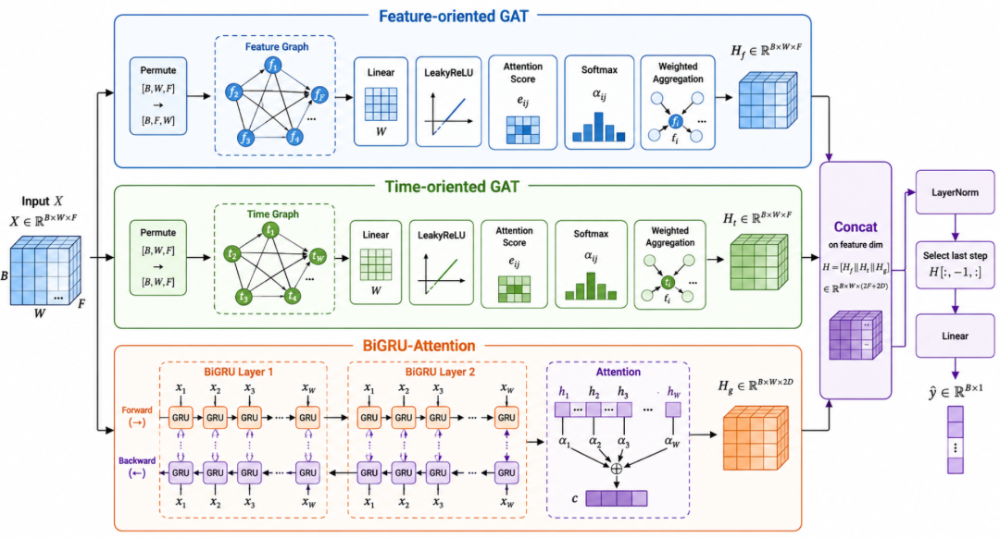
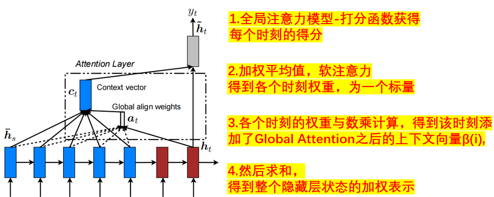
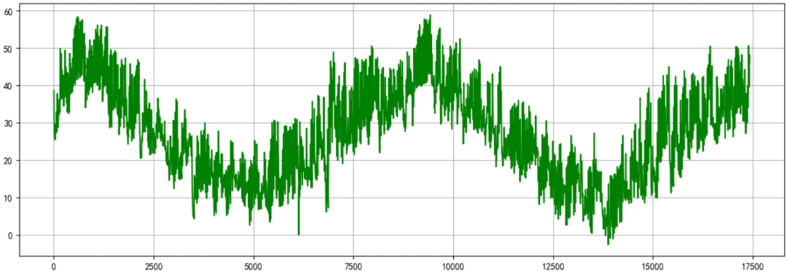
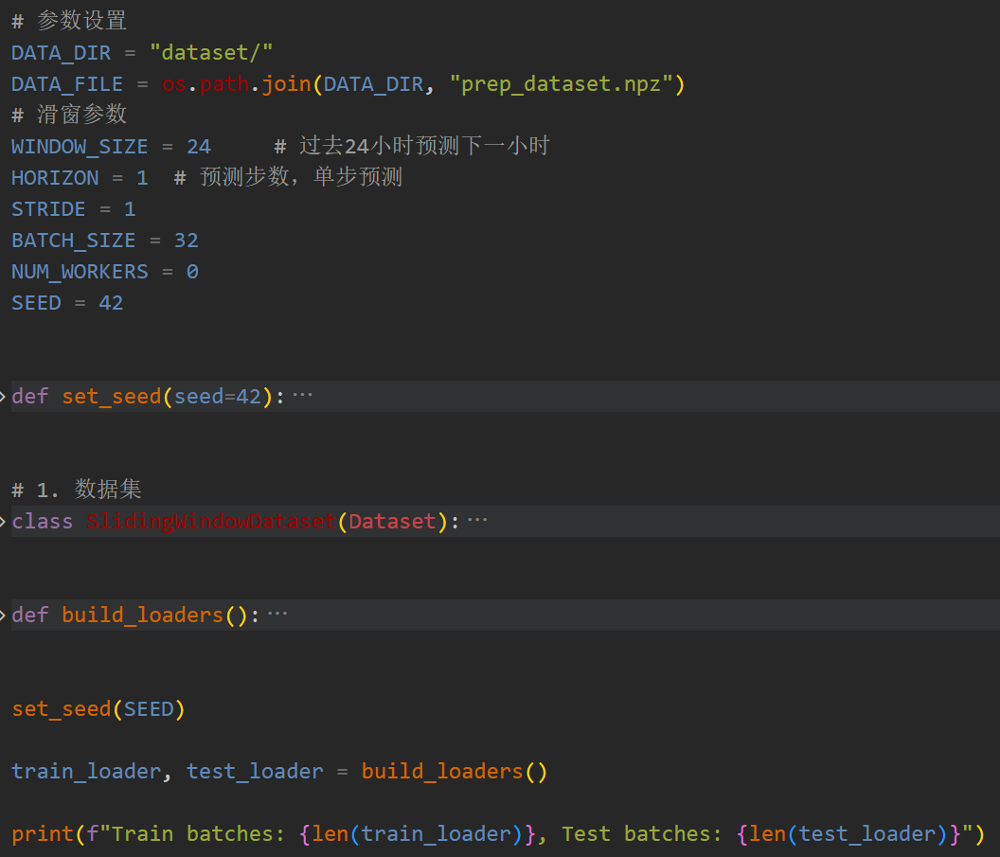
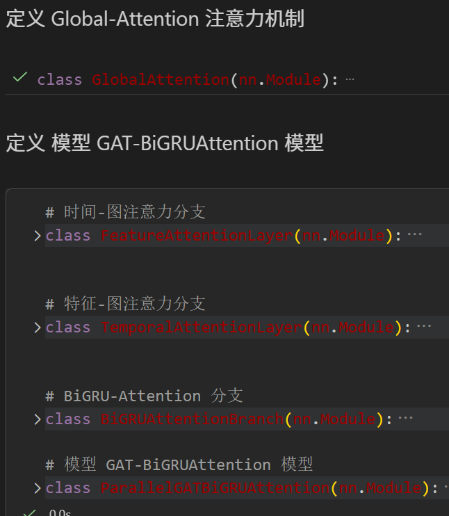
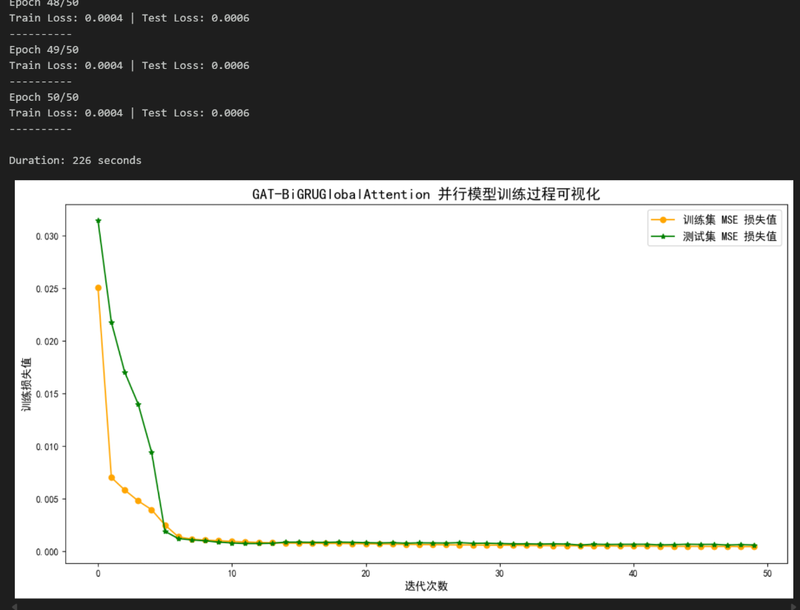
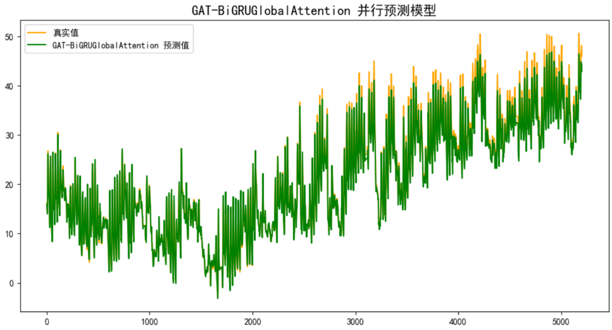
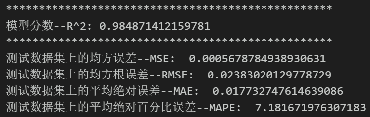
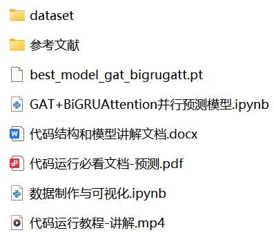

<!-- PAYMENT_BLOCK -->

## Get this dataset

- Payment link (Stripe): [Buy now](https://buy.stripe.com/3cs8yP7sY87d0vu9AB)
- Payment QR code: 

<!-- /PAYMENT_BLOCK -->
